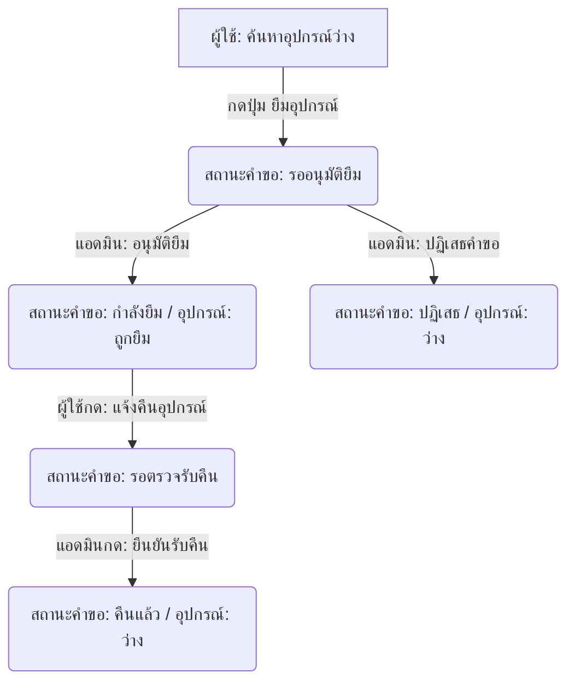

# ระบบยืม-คืนคอมพิวเตอร์และโน้ตบุ๊ก (IT Borrow-Return System)

ระบบยืม-คืนอุปกรณ์ IT และโน้ตบุ๊กภายในองค์กร พัฒนาด้วย **PHP Native (PDO)**, **MySQL**, **Bootstrap 5**, **DataTables** และ **SweetAlert2** เพื่อให้สามารถคัดลอกไปรันบน XAMPP ได้ทันทีโดยไม่ต้องติดตั้ง Library ภายนอกเพิ่มเติม

---

## 📁 โครงสร้างโฟลเดอร์ของโปรเจกต์

```text
project/
├── config/
│   └── database.php           # ไฟล์เชื่อมต่อฐานข้อมูลผ่าน PDO
├── assets/
│   ├── css/
│   │   └── style.css          # ไฟล์ปรับแต่งดีไซน์เพิ่มเติม (เช่น Sidebar, Glassmorphism)
│   └── js/
│       └── main.js            # สคริปต์หลักสำหรับประมวลผลทั่วไป
├── auth/
│   ├── login.php              # หน้าเข้าสู่ระบบ
│   ├── register.php           # หน้าลงทะเบียนผู้ใช้งานใหม่
│   └── logout.php             # สคริปต์ออกจากระบบและทำลาย Session
├── includes/
│   ├── header.php             # แท็ก Head, แหล่งดึง CDN และตัวเช็คสิทธิ์ (Security)
│   ├── sidebar.php            # เมนูด้านข้างที่ปรับเปลี่ยนตามสิทธิ์การใช้งาน (Admin/User)
│   └── footer.php             # แท็กปิด HTML และสคริปต์ DataTables/SweetAlert2
├── admin/
│   ├── dashboard.php          # แดชบอร์ดสรุปสถิติจำนวนอุปกรณ์และรายการขอยืม
│   ├── devices.php            # หน้าจัดการข้อมูลอุปกรณ์ (CRUD) เพิ่ม/แก้ไข/ลบ
│   ├── users.php              # หน้าจัดการข้อมูลสมาชิก (CRUD) เพิ่ม/แก้ไข/ลบ
│   ├── requests.php           # หน้าอนุมัติคำขอยืม และ ตรวจรับคืนอุปกรณ์
│   ├── reports.php            # หน้ารายงานประวัติการยืม-คืนแบบคัดกรองวันที่/สถานะ
│   └── export_excel.php       # สคริปต์ส่งออกข้อมูลในตารางรายงานออกมาเป็นไฟล์ Excel
├── user/
│   ├── devices.php            # หน้ารายการอุปกรณ์ทั้งหมดและส่งคำขอยืม
│   ├── requests.php           # หน้าตรวจสอบสถานะของตนเองและแจ้งคืนอุปกรณ์
│   └── history.php            # หน้าประวัติการทำรายการยืม-คืนที่เสร็จสิ้นแล้วของตนเอง
├── index.php                  # ไฟล์ควบคุมหลัก ตรวจสอบสิทธิ์แล้วจัดเส้นทาง (Router)
└── database.sql               # ไฟล์โครงสร้างฐานข้อมูล MySQL และข้อมูลทดสอบ (Seed Data)
```

---

## 🛠️ ขั้นตอนการติดตั้งและรันบน XAMPP

### 1. ย้ายโปรเจกต์ไปยัง XAMPP htdocs
- ทำการคัดลอกโฟลเดอร์โปรเจกต์นี้ทั้งหมด (เช่น คัดลอกโฟลเดอร์ `project`)
- นำไปวางในโฟลเดอร์เซิร์ฟเวอร์จำลองของ XAMPP โดยทั่วไปคือ:
  `C:\xampp\htdocs\`
  *(เส้นทางปลายทางจะเป็น `C:\xampp\htdocs\project\`)*

### 2. เปิดการทำงานของเซิร์ฟเวอร์
- เปิดโปรแกรม **XAMPP Control Panel** ขึ้นมา
- กดปุ่ม **Start** ที่หัวข้อ **Apache** และ **MySQL** เพื่อเริ่มต้นทำงาน

### 3. นำเข้าฐานข้อมูลผ่าน phpMyAdmin
- เปิดโปรแกรมเปิดเว็บ (เช่น Google Chrome) แล้วเข้าไปที่: [http://localhost/phpmyadmin/](http://localhost/phpmyadmin/)
- คลิกที่เมนู **"New" (สร้างฐานข้อมูลใหม่)** ที่คอลัมน์ซ้ายมือ
- ตั้งชื่อฐานข้อมูลว่า `borrow_db` เลือกการเข้ารหัสภาษาเป็น `utf8mb4_unicode_ci` แล้วกดปุ่ม **Create (สร้าง)**
- คลิกที่แท็บ **"Import" (นำเข้า)** เมนูด้านบน
- กดเลือกไฟล์ (Choose File) แล้วเลือกไฟล์ชื่อ `database.sql` จากโฟลเดอร์โปรเจกต์
- เลื่อนลงมาล่างสุดแล้วกดปุ่ม **"Import" (หรือ "Go")** เพื่อทำการรันคำสั่งสร้างตารางและใส่ข้อมูลจำลอง

### 4. รันแอปพลิเคชัน
- เปิดเบราว์เซอร์ไปที่ลิงก์: [http://localhost/project/](http://localhost/project/)
- ระบบจะนำท่านไปยังหน้า **Login (เข้าสู่ระบบ)** โดยอัตโนมัติ

---

## 🔑 บัญชีผู้ใช้งานสำหรับการทดสอบระบบ (Seed Data)

> [!NOTE]
> รหัสผ่านสำหรับทุกบัญชีเริ่มต้นคือ: **`password123`**

### 1. สิทธิ์ผู้ดูแลระบบ (Admin Role)
- **ชื่อผู้ใช้งาน (Username):** `admin`
- **รหัสผ่าน (Password):** `password123`
- *สิทธิ์ในการอนุมัติคำขอยืม-คืน, จัดการอุปกรณ์, จัดการข้อมูลผู้ใช้งาน, และดูรายงาน Export Excel*

### 2. สิทธิ์ผู้ใช้งานทั่วไป (User Role)
- **ชื่อผู้ใช้งาน (Username):** `somchai`
- **รหัสผ่าน (Password):** `password123`
- **ชื่อผู้ใช้งาน (Username):** `somsri`
- **รหัสผ่าน (Password):** `password123`
- *สิทธิ์ในการขอยืมอุปกรณ์, ตรวจดูสถานะของตนเอง, แจ้งคืนอุปกรณ์ที่ยืมอยู่, และตรวจสอบประวัติการยืมส่วนตัว*

---

## 📊 สถานะและกระบวนการทำงานของระบบ (Workflow)



1. **ผู้ใช้ขอยืม**: ผู้ใช้อุปกรณ์ที่สถานะว่างปุ่มจะเป็นสีน้ำเงิน สามารถกดกรอกวันที่ยืม-คืนพร้อมระบุเหตุผลได้ทันที
2. **แอดมินประมวลผลคำขอ**: แอดมินจะเห็นการแจ้งเตือนและรายการคำขอยืมใหม่ สามารถกด **อนุมัติ** หรือ **ปฏิเสธ** ได้
3. **การแจ้งคืน**: เมื่อผู้ใช้งานใช้อุปกรณ์เสร็จสิ้น สามารถเข้ามายังหน้า "สถานะคำขอ/คืน" แล้วกดปุ่ม **แจ้งคืนอุปกรณ์** เพื่อเปลี่ยนสถานะคำขอเป็น **รอตรวจรับคืน**
4. **ยืนยันการคืน**: เมื่อผู้ใช้นำอุปกรณ์ส่งกลับมายังฝ่าย IT แอดมินจะตรวจรับและกดปุ่ม **ยืนยันรับคืน** อุปกรณ์จะกลับมาเป็น **ว่าง** และสามารถยืมใหม่ได้ทันที
# IT-Borrow
